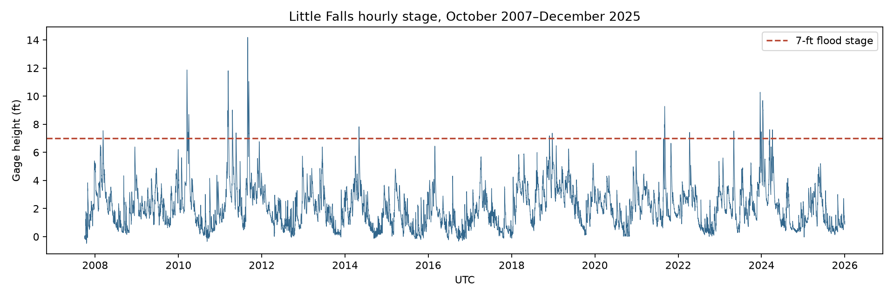
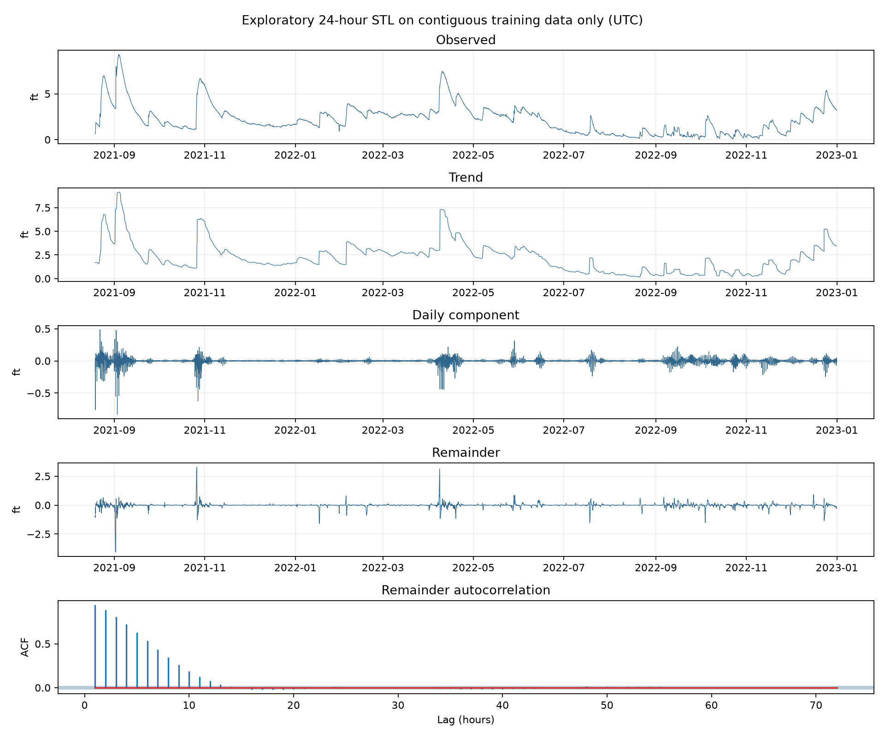
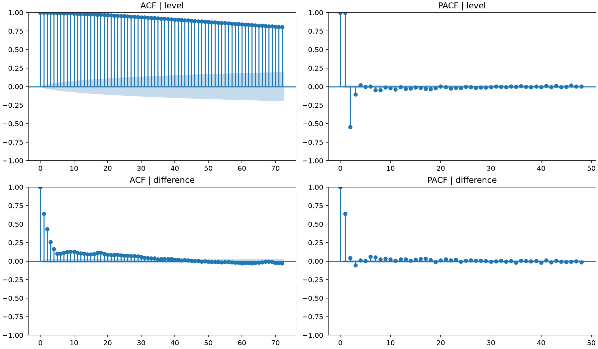
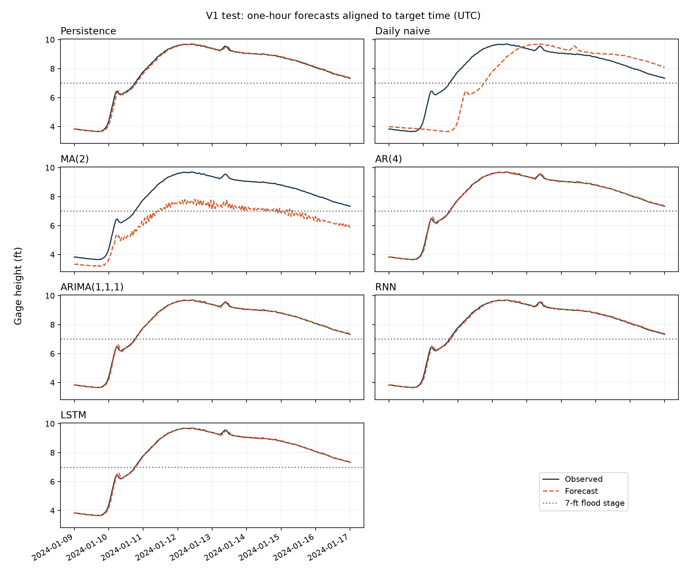
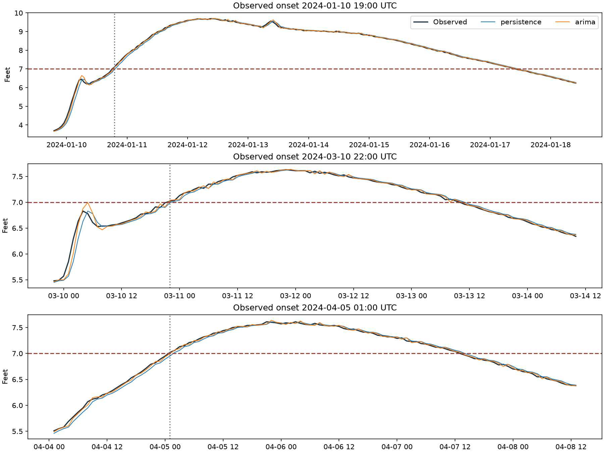
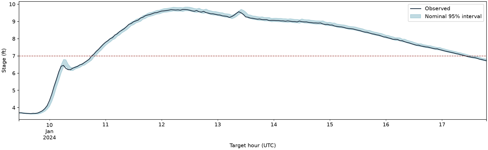

# One-hour River-Stage Forecasting at Little Falls, New Jersey

Time-Series Forecasting Course Project Authors: Sudarshan Adhikari and Top Raj KC Course: CSE-681 PRA · Instructor: Pritam Anand Submission date: 24 November 2026

## Management summary

### Problem and objective

The National Weather Service (NWS) identifies 7.0 ft as minor flood stage on the Passaic River at Little Falls [2]. We asked whether a one-hour stage forecast could help municipal staff decide when to review observations and official forecasts.

We used hourly USGS river-stage observations from October 2007 to December 2025 and predicted the stage one hour ahead. We compared persistence, daily naive, MA, AR, ARIMA, RNN, and LSTM. We also studied a 95% prediction interval from two quantile LSTMs.

### Recommendation and action

For this course study, we selected ARIMA(1,1,1) because it had the lowest RMSE on the 2023 validation data and performed almost the same as AR(4) in the final test. Its test RMSE was 0.02315 ft, compared with 0.02997 ft for persistence, or about 22.8% less. The proposed use is a supplemental check alongside NWS forecasts.

We propose a staffed shadow trial. When the forecast for the next hour is at or above 7.0 ft, a staff member checks whether the USGS reading is recent, how quickly the stage is rising, and the current NWS forecast and warnings. Staff may then pass the information to the municipal Office of Emergency Management (OEM) for review under its existing procedures. Our model would not issue a public warning, close roads, or order evacuation by itself.

### Benefits and risks from our test

On 17,544 common test hours in 2024–2025, ARIMA correctly flagged 281 of 282 flood-stage hours, missed one hour and had zero false-positive hours. It matched all three observed flood episodes. Its first retrospective forecast flags preceded the first raw USGS 7-ft readings by 15 minutes, 60 minutes, and 0 minutes. These are not confirmed real-world warning times because data delivery and staff response delays were not measured.

We assigned hypothetical costs of $500 per missed flood hour, $100 per false-positive hour, and $25 per flagged hour. The two-year calculation gives $7,525 for ARIMA and $8,850 for persistence, a modeled difference of $1,325. The example charges for every flagged hour, including repeated flags during the same event.

Our nominal 95% LSTM interval covered 95.83% of all test hours and 29.63% of the 135 rapid-rise hours. With only three independent test floods and unknown live data delay, we recommend further observation in shadow mode rather than an automatic flood-warning application.

## 1. Introduction and study objectives

### 1.1 Why we selected Little Falls

The Passaic River has caused flooding in Little Falls and nearby communities. According to the NWS gauge-impact table, 7.0 ft is the beginning of minor flooding in Little Falls, Wayne and Lincoln Park. 8.0 ft is moderate flood stage and 9.0 ft is major flood stage. At 9.5 ft, the listed impacts include worsening flooding and water entering homes on William Street and Zeliff Avenue in Little Falls [2]. These values help explain why forecasting the river level matters. They are gauge-stage reference points, not a map of which individual property will flood.

The Township of Little Falls provides links to the Passaic River NWS hydrograph, inundation maps, rainfall information and its OEM office [3]. The municipal OEM coordinates emergency-management activities [4]. This means our model should support an existing review process and not create a separate unofficial warning system.

### 1.2 Objectives

We set four main objectives for the course project:

1. Use actual USGS observations to predict river stage one hour ahead in feet.
2. Compare classical models (MA, AR, ARIMA) and neural models (RNN, LSTM) against simple forecasting baselines.
3. Check model errors during floods, especially when the river rises quickly and crosses 7.0 ft.
4. Show how a forecast and its uncertainty could support a realistic staff-review decision, including an example of costs and risks.

The main output is a numerical stage forecast, not a flood-inundation map. We use 7.0 ft for the binary flood-stage decision. 6.5 ft is NWS action stage and is included only as background information [2, 5].

## 2. Data collection and checking

We used USGS station 01389500, parameter 00065 (gage height, feet). The raw observations were mostly recorded every 15 minutes. For each hourly cutoff, we took the latest observation available up to that cutoff. We left missing periods unfilled.

| Data item | Verified value |
|:--|--:|
| Raw USGS readings, Oct 2007–Dec 2025 | 638,644 |
| Total hourly study cutoffs | 160,008 |
| Valid hourly stage values | 159,695 |
| Missing hourly stage values | 313 (0.196%) |
| Observed hourly stage range | -0.49 to 14.19 ft |
| Independent observed flood episodes (stage ≥ 7 ft) | 20 |
| Flood-stage hours | 2,004 |

The largest gap was 184 hours from 30 December 2018 to 7 January 2019, and another historical gap lasted 42 hours in July 2009. We did not assume that those missing hours were dry. All 16 original dataset checks passed, and the data were saved in the GitHub `dataset-v1.0.0` release [1, 8].

*Figure 1. Hourly stage at Little Falls between 2007 and 2025.*

Figure 1 shows that the stage stayed below 7 ft for most hours. There are some large peaks, mainly in 2010 and 2011. The highest hourly reading was 14.19 ft in August 2011. We also see that the river rises during a storm and often decreases more slowly afterward. This is why we checked flood-time errors separately from average prediction error.

### 2.1 Training, validation and test data

We kept observations in time order for all models and did not shuffle the target hours.

| Period | Dates (UTC) | Study hours | Missing | Flood events | Hours ≥ 7 ft |
|:--|:--|--:|--:|--:|--:|
| Training | Oct 2007–Dec 2022 | 133,704 | 313 | 14 | 1,485 |
| Validation | Jan–Dec 2023 | 8,760 | 0 | 3 | 237 |
| Final test | Jan 2024–Dec 2025 | 17,544 | 0 | 3 | 282 |

A new independent flood episode required 24 consecutive observed hours below 7 ft after the previous episode. Missing data do not count as proof that a flood ended. Model inputs were restricted to observations available at or before issuance time. The V1 hyperparameters were selected using 2023 validation and frozen before test scoring.

## 3. Understanding the time series

### 3.1 Trend and daily seasonality

We used 12,000 complete training hours from August 2021 to December 2022 for an example of STL decomposition. A continuous period was used because the full series contains gaps. This example does not represent all years equally.

*Figure 2. Trend, daily component and remainder of the training data.*

In Figure 2, the trend follows the bigger rises and falls. The daily seasonal component is mostly small, and we did not see a clear repeating pattern every day. The remainder has a few sharp peaks, and its autocorrelation is still high at short lags. So the remainder is not white noise. The calculated daily seasonal-strength index was 0 in this sample.

### 3.2 ACF, PACF and stationarity

*Figure 3. Autocorrelation before and after differencing.*

Figure 3 shows that the original ACF decreases slowly. For example, ACF at lag 24 was 0.9552 for stage levels. After using hourly changes, `H(t) - H(t-1)`, the lag-24 ACF became 0.0782. This indicates that much of the first correlation comes from the river staying high or low for a long time, rather than a daily repeating cycle. PACF suggested that recent lags were important, so we tested small AR orders.

On the training block, ADF rejected its unit-root null for the levels (p = 0.000155), while KPSS rejected its level-stationarity null (p ≤ 0.01). This leaves mixed evidence about stationarity in the levels. After first differencing, ADF rejected a unit root (p ≈ 7.47 × 10⁻²⁹) and KPSS did not reject stationarity (reported lower bound p ≥ 0.10). We considered d = 1 and selected the final orders by validation error. The daily screen required differenced autocorrelations at lags 24 and 48 to both reach 0.15. They did not, so we omitted optional SARIMA.

## 4. Models and parameter selection

All models predict stage at the next hourly cutoff. Persistence and daily naive serve as baselines.

| Model | What it uses | Selected V1 settings |
|:--|:--|:--|
| Persistence | Last observed stage | Forecast `H(t+1) = H(t)` |
| Daily naive | Earlier daily stage | `H(t+1) = H(t-23)` |
| MA | Present and past error innovations | MA(2): `q = 2` |
| AR | Past river-stage values | AR(4): `p = 4` |
| ARIMA | AR terms, differencing, error terms | ARIMA(1,1,1): `p = 1, d = 1, q = 1` |
| RNN | A sequence of previous stages | 24 h lookback, 16 units, 2 layers, epoch 13 |
| LSTM | Previous stages with gated recurrent memory | 24 h lookback, 16 units, 2 layers, epoch 16 |
| Quantile LSTM | Two estimated forecast quantiles | 2.5% / 97.5%, best epochs 4 / 13 |

For the RNN, LSTM and quantile LSTMs, the selected setting was batch size 384, learning rate 0.002, Adam optimizer and seed 42. The epoch cap was 16, and validation early stopping was used. The neural searches also tested other lookbacks, unit sizes and learning rates. The classical candidates were selected by the lowest validation RMSE among converged fits [8].

The classical fits used the last 8,000 consecutive training hours, including one flood episode. Neural training sampled 18,000 valid windows over the longer training record, including targets from all 14 training floods. So the model families did not receive exactly the same training exposure. We can compare their final forecasts, but cannot say that one model family is always better in general.

### 4.1 Experimental setup and tuning details

We followed the same forecasting rule for every model: use readings available at time `t` to predict the river stage at `t+1` hour. The training years came first, then validation in 2023, then the final test in 2024–2025. We selected parameters by validation error, not by looking for a smaller final-test error. The V1 models were frozen before the final test. Forecasts from all seven point models were evaluated on the same 17,544 valid test hours.

| Part of experiment | Settings and how we checked them |
|:--|:--|
| Classical training | Last 8,000 continuous training hours, ending on 31 Dec 2022. This block included one flood event and 57 flood-stage hours. |
| MA, AR and ARIMA search | Compared candidate model orders and convergence. MA(2), AR(4), and ARIMA(1,1,1) had the smallest 2023 validation RMSE among their converged V1 candidates. |
| RNN/LSTM candidates | Tried lookbacks of 12, 24 and 36 hours; 12, 16 and 24 hidden units; one or two layers; batch sizes 256 and 384; and learning rates 0.001, 0.0015 and 0.002 in a bounded search. Not every possible combination was run. |
| Neural training | Used 18,000 valid, overlapping training windows sampled across the older training years; the selected 24-hour windows included 200 flood targets from all 14 training floods. Adam optimizer, seed 42, maximum 16 epochs, and early-stopping patience 7. |
| Selected RNN | Lookback 24 hours, 16 units, two layers, batch 384, learning rate 0.002, saved epoch 13. |
| Selected LSTM | Lookback 24 hours, 16 units, two layers, batch 384, learning rate 0.002, saved epoch 16. Other seeds were checked on validation but did not replace the frozen seed-42 result. |
| Quantile LSTMs | Separate 2.5% and 97.5% quantile models used pinball loss; selected epochs 4 and 13 from validation. |

The search compared the configurations listed above. Differences in training coverage limit conclusions about the model families as a whole.

### 4.2 Model equations

Let *H(t)* be stage in feet at hourly cutoff *t*, and let ε(t) be the error innovation at hour *t*. The models forecast *H(t+1)* using observations through *t*.

#### MA(2), AR(4), and ARIMA(1,1,1)

MA(2) models stage as a constant μ plus the current and two previous innovations. The terms θ₁ and θ₂ are fitted weights. The next innovation has an expected value of zero at forecast time.

H(t) = μ + ε(t) + θ1ε(t−1) + θ2ε(t−2)(1)

AR(4) uses four previous hourly stages, with intercept <i>c</i> and fitted weights φ₁ through φ₄.

H(t) = c + φ1H(t−1) + φ2H(t−2) + φ3H(t−3) + φ4H(t−4) + ε(t)(2)

ARIMA(1,1,1) has one autoregressive lag, one difference and one lagged innovation, so <i>p</i> = <i>d</i> = <i>q</i> = 1. The lag operator <i>B</i> shifts the series back an hour, giving <i>H(t)−H(t−1)</i> for the first difference. The fitted model has no drift.

(1−φB)(1−B)H(t) = (1+θB)ε(t)(3)

#### Two-layer RNN and LSTM

At each step <i>j</i> in the input window, the first recurrent layer receives stage standardized with the training mean and standard deviation. The second layer receives the first layer’s hidden output. For either layer, the RNN updates its hidden state <i>h</i> from the current input <i>x</i> and its own previous state.

hj = tanh(Wxj + Uhj−1 + b)(4)

The LSTM uses the same two-layer input structure. Its input, forget, and output gates <i>i</i>, <i>f</i>, and <i>o</i> use the sigmoid function σ. The candidate <i>g</i> and previous memory <i>C</i> determine the new cell state. The symbol ⊙ means elementwise multiplication. Weights <i>W</i>, <i>U</i> and biases <i>b</i> are fitted for each layer and gate.

ij = σ(Wixj + Uihj−1 + bi), &nbsp;
fj = σ(Wfxj + Ufhj−1 + bf) 
oj = σ(Woxj + Uohj−1 + bo), &nbsp;
gj = tanh(Wgxj + Ughj−1 + bg) 
Cj = fj ⊙ Cj−1 + ij ⊙ gj, &nbsp;
hj = oj ⊙ tanh(Cj)
(5)

Both models use the top layer’s final hidden state <i>h</i>t. The linear readout predicts a change in standardized units. The training standard deviation <i>s</i> converts the change to feet, and the model adds it to the latest stage. The readout learns weights <i>w</i> and bias <i>a</i>.

Ĥ(t+1) = H(t) + s(wTht + a)(6)

#### Quantile LSTM

The two quantile LSTMs use the same residual readout. Each minimizes pinball loss for <i>u</i>, the observed stage minus the predicted quantile on the standardized scale. The quantiles τ = 0.025 and 0.975 form the nominal 95% prediction interval.

ρτ(u) = max(τu, (τ−1)u)(7)

### 4.3 Additional V2 experiments (historical validation only)

After the frozen V1 test, we ran a separate V2 study with five earlier validation years (2014, 2018, 2021, 2022 and 2023). Each fold fitted models using earlier years and used only observations through the forecast cutoff for each prediction. The classical study checked AR orders 1, 2, 3, 4, 6, 8, 12 and 24 and nine bounded ARIMA orders; failed or slow fits were recorded. It also compared 8,000-hour versus longer fitting histories. Neural experiments checked different lookbacks, model sizes, learning rates, and longer training. The V2 RNN and LSTM finalists used a 36-epoch cap, with 24-hour lookback, 16 units, two layers, batch 384 and learning rate 0.002.

The five V2 folds were used for selection and comparison. The 2024–2025 period had already been examined in V1, and V2 underwent no fresh independent test. The [V2 supplement](https://github.com/Sudarshan-info/little-falls-flood-forecasting/tree/main/docs/research_v2) provides saved fold results, candidate comparisons, and reproduction instructions [11].

## 5. Model accuracy and figures

### 5.1 Frozen V1 validation and final test

All seven point models were compared on the same 17,544 complete hourly test targets. RMSE and MAE are in feet. RMSE gives more weight to large errors, and MAE measures the average absolute error. MAPE divides absolute error by the magnitude of observed stage. Small magnitudes can inflate it, and negative stages relative to the gauge datum complicate its interpretation. The scoring rule excludes observed magnitudes at or below the larger of 10⁻⁸ ft and 1% of the common sample mean absolute stage. It excluded no validation or test targets. R² compares squared error with a constant-mean forecast [9].

| Model | Val. RMSE | Val. MAE | Test RMSE | Test MAE | Test MAPE | Test R² |
|:--|--:|--:|--:|--:|--:|--:|
| Persistence | 0.03341 | 0.01460 | 0.02997 | 0.01244 | 0.9058% | 0.999660 |
| Daily naive | 0.45411 | 0.26547 | 0.37061 | 0.21357 | 12.3071% | 0.948065 |
| MA(2) | 0.45985 | 0.31817 | 0.43602 | 0.33296 | 30.5480% | 0.928117 |
| AR(4) | 0.02464 | 0.01175 | 0.02313 | 0.01043 | 0.8241% | 0.999798 |
| ARIMA(1,1,1) | 0.02461 | 0.01174 | 0.02315 | 0.01041 | 0.8182% | 0.999797 |
| RNN | 0.02685 | 0.01332 | 0.02476 | 0.01143 | 0.8334% | 0.999768 |
| LSTM | 0.02505 | 0.01155 | 0.02342 | 0.01017 | 0.8097% | 0.999793 |

AR(4) had the lowest final-test RMSE, and LSTM had the lowest final-test MAE. ARIMA(1,1,1) had the lowest validation RMSE, which is why it was selected for the management example. The difference between AR and ARIMA final-test RMSE was only about 0.000018 ft, so we cannot say one is clearly better. AR, ARIMA, RNN and LSTM all did better than persistence on test RMSE and MAE.

*Figure 4. Actual and forecast river stages for all seven models during the January 2024 flood.*

Figure 4 shows that AR, ARIMA, RNN and LSTM follow the observed stage closely. The daily naive and MA forecasts are further away. Still, the differences are larger during the beginning of a fast river rise than during steady hours.

### 5.2 Extra V2 tuning (historical validation only)

We also ran V2 with five expanding-window validation years: 2014, 2018, 2021, 2022 and 2023. It was not evaluated on a new independent test period. On 43,775 common validation hours, the results were:

| V2 model | Best settings | Five-fold RMSE (ft) | MAE (ft) |
|:--|:--|--:|--:|
| Persistence | Last stage | 0.03436 | 0.01393 |
| AR | AR(3), 8,000-hour cap | 0.02747 | 0.01218 |
| ARIMA | ARIMA(2,0,1), 8,000-hour cap | 0.02746 | 0.01217 |
| RNN | 24 h, 16 units, 2 layers, 36-epoch cap | 0.02758 | 0.01215 |
| LSTM | 24 h, 16 units, 2 layers, 36-epoch cap | 0.02788 | 0.01201 |

Compared with the matched 16-epoch controls, the 36-epoch caps lowered pooled RMSE by about 0.00054 ft for RNN and 0.00042 ft for LSTM. Increasing the classical fitting-history cap improved pooled RMSE for none of the five paired orders [11]. The AR(3) and ARIMA(2,0,1) validation RMSEs differed by less than 0.00001 ft.

## 6. Flood-stage forecasts and real management use

### 6.1 What 7 ft means locally

The NWS impact table says minor flooding starts at 7.0 ft in Little Falls, Wayne and Lincoln Park. It lists more serious flooding at higher stages. Around 9.5 ft, flooding in Little Falls worsens and homes on William Street and Zeliff Avenue can take on water [2]. Our January 2024 test episode reached 9.69 ft on the hourly series. This does not prove which roads or houses actually flooded in that event, but it shows why a manager would want to compare model estimates with official impact information rather than looking at RMSE alone.

The Township of Little Falls already points to NWS river-stage forecasts and maps [3], while its OEM is responsible for planning and coordinating response [4]. A nearby municipality, Wayne, has also described using the Little Falls Passaic gauge in its established flood-warning process [6]. Our one-hour model should therefore be considered an additional short-term check, not a better replacement for existing NWS forecasts, which can provide a much longer outlook.

### 6.2 Proposed staff decision rule

The following workflow is a proposed classroom scenario. It is not a verified existing Little Falls operating procedure.

| Situation | Suggested staff action |
|:--|:--|
| Forecast below 7 ft; readings fresh | Continue routine monitoring and follow official alerts. |
| Forecast ≥ 7 ft for the next hour | Flag for duty-staff review; check USGS time stamp, present stage, recent rise, NWS forecast and any current warnings. |
| Stage rising fast or upper uncertainty limit is high | Give the situation closer human attention even when the point estimate is below 7 ft; do not rely on interval coverage during rapid rises. |
| Official warnings or local impact reports indicate danger | Follow existing OEM and public-safety procedures; qualified staff decide on field checks, traffic control or public notification. |
| Gage reading missing or late | Mark the model forecast unavailable, and rely on official sources and established monitoring procedures. |

A real office should record when an alert was received, who reviewed it, what official evidence was checked, and whether action followed. Repeated hourly flags during one continuous flood should normally be grouped into an episode rather than treated as separate emergency calls. NWS and NJOEM remain the public-warning and safety information sources [2, 4, 7].

### 6.3 Actual archived warning counts

We converted each stage forecast into a flood-stage flag when predicted stage was at least 7.0 ft. In the final V1 2024–2025 test:

| Model | Correct flood hours (TP) | Missed hours (FN) | False-positive hours (FP) | Flood episodes detected |
|:--|--:|--:|--:|--:|
| Persistence | 279 | 3 | 3 | 3 / 3 |
| Daily naive | 210 | 72 | 87 | 3 / 3 |
| MA(2) | 86 | 196 | 0 | 1 / 3 |
| AR(4) | 281 | 1 | 0 | 3 / 3 |
| ARIMA(1,1,1) | 281 | 1 | 0 | 3 / 3 |
| RNN | 281 | 1 | 3 | 3 / 3 |
| LSTM | 281 | 1 | 0 | 3 / 3 |

MA missed two of the three floods. Daily naive produced one separate false-alert episode. None of the other models produced a separate false-alert episode, though persistence and RNN still flagged some below-threshold hours.

A model can detect an episode after it starts. Therefore, 3/3 episodes detected is not the same as 3 useful early warnings. The three ARIMA retrospective first-alert times were:

| Flood onset in 2024 | First matched forecast issuance (UTC) | First raw USGS reading ≥ 7 ft | Lead to raw crossing |
|:--|:--|:--|--:|
| January 10 | 18:00 | 18:15 | 15 min |
| March 10 | 21:00 | 22:00 | 60 min |
| April 5 | 01:00 | 01:00 | 0 min |

On April 5 the model missed the first flood target and identified the event later. These lead times use archived measurements and do not include real USGS publishing delay, how long a computer takes to issue a forecast, or staff action time.

*Figure 5. January, March and April 2024 flood episodes.*

Figure 5 shows that the model tracks the flood after it becomes high, but it is harder to predict the very start of a rapid rise. On 135 rapid-rise test hours, AR and ARIMA underpredicted about 92% of the time, and RNN and LSTM about 96%. These errors are concentrated in the hours when early detection matters most.

### 6.4 Management cost example — assumptions, not savings

The cost calculation assigns an assumed rate to each type of hour.

Assumed cost = $500(Nmissed) + $100(Nfalse) + $25(Nflagged)(8)

The three counts are missed flood hours, false-positive hours, and all flagged hours. The dollar amounts are hypothetical. The archived test gives the following totals under those assumptions.

| Scenario | No supplemental model flag | Persistence-based flag | ARIMA-based flag |
|:--|--:|--:|--:|
| $500 per missed flood hour, $100 per false hour, $25 per flagged hour | $141,000 | $8,850 | $7,525 |
| $10 per missed flood hour, same other amounts | $2,820 | $7,380 | $7,035 |

The first scenario gives ARIMA a hypothetical cost $1,325 below persistence. Under the second scenario, both model flags cost more than the no-supplemental-flag baseline. That baseline assumes existing NWS alerts and OEM monitoring continue.

A shadow pilot could measure review time, duplicate flags, false-alert episodes, communication delays, and field-check costs. Those observations would support cost estimates per review or staff action.

## 7. Prediction interval, risk and reliability

We trained two LSTM models with pinball loss to estimate the 2.5% and 97.5% quantiles. This produces a nominal 95% prediction interval. PICP is the percentage of observed stages falling inside that interval; MPIW is its average width. A rapid rise is an observed hourly increase at or above the training 99th percentile, approximately 0.12 ft/h. The test interval covered 40 of those 135 hours.

| V1 data subset | Hours | Coverage (PICP) | Mean width (MPIW) |
|:--|--:|--:|--:|
| 2023 validation, all hours | 8,760 | 95.10% | 0.0613 ft |
| 2024–2025 test, all hours | 17,544 | 95.83% | 0.0580 ft |
| Test, rising while stage ≥ 7 ft | 97 | 95.88% | 0.1813 ft |
| Test, rapid rises by training Q99 criterion | 135 | 29.63% | 0.1928 ft |

The quantile pair also had 10 test-hour crossings, where its raw lower prediction was above its raw upper prediction. We ordered the two bounds before plotting and scoring. This fixes their order without correcting the underlying errors.

*Figure 6. Observed stage and 95% forecast interval near the January flood.*

Figure 6 gives a small band around the forecast, but that band was often too low during sudden rises. The overall 95.83% coverage can therefore give a better impression than the rapid-rise behavior deserves. For staff, an interval that crosses 7 ft is a reason to check the newest observations and NWS information; an interval below 7 ft must not cancel an official flood warning.

## 8. Conclusion and limitations

We found that AR(4), ARIMA(1,1,1), RNN and LSTM predicted next-hour stage more accurately than persistence on the same 2024–2025 test hours. AR(4) had the smallest RMSE, while LSTM had the smallest MAE. The classical AR/ARIMA models were nearly tied in V1 and were still strong in five-fold V2 validation.

The biggest problem was predicting the start of a flood and fast river rises, not tracking a river level once it has become high. The test contained only three flood events and no measured alert-delivery times. The interval also performed poorly during rapid rises. For this reason, we recommend that any model-based alert be tried only as an additional staff-reviewed shadow tool, while NWS and local OEM remain responsible for official warnings and emergency decisions.

### Declaration of AI Assistance

The authors, Sudarshan Adhikari and Top Raj KC, were responsible for the main research decisions, including selecting the study location, choosing the USGS dataset, defining the research objectives, and deciding the forecasting and flood-warning approach.

OpenAI ChatGPT and Codex were used to assist with Python coding, data processing, model implementation, hyperparameter tuning, graph preparation, and report writing. The authors guided the research process, reviewed the results, and made the final decisions about the analysis and conclusions.

AI tools were used as supporting tools throughout the project. The authors take responsibility for the final report and its findings.

### Reproducibility and report files

The canonical dataset and frozen V1 evidence are available in our public [GitHub repository](https://github.com/Sudarshan-info/little-falls-flood-forecasting). See the [dataset release](https://github.com/Sudarshan-info/little-falls-flood-forecasting/releases/tag/dataset-v1.0.0) and the [frozen V1 publication](https://github.com/Sudarshan-info/little-falls-flood-forecasting/commit/dfa384eb200903d2eb90c9ebe4d8a418e504a87e) for the data, research code and selected model settings. The V1 test used 2024–2025 after validation selection. V2 used historical validation only.

### References

1. U.S. Geological Survey. *Passaic River at Little Falls, NJ*, station 01389500, parameter 00065. [Source](https://waterdata.usgs.gov/monitoring-location/USGS-01389500)
2. National Weather Service, Middle Atlantic River Forecast Center. *Passaic River at Little Falls: flood categories and stage-specific impacts*. [Source](https://www.weather.gov/media/marfc/MARFC_FcstPt/PSC/LittleFalls.pdf)
3. Township of Little Falls. *Flood Management*. [Source](https://littlefallsnj.gov/flood-management)
4. Township of Little Falls. *Office of Emergency Management*. [Source](https://littlefallsnj.gov/office-emergency-management)
5. NOAA National Water Prediction Service. *Passaic River at Little Falls, LTFN4*. [Source](https://water.noaa.gov/gauges/ltfn4)
6. Township of Wayne (2014). *Flood Plain Management Plan*, section on flood warning and the Little Falls gauge. [Source](https://waynetownship.com/wp-content/uploads/2017/12/Flood%20Plain%20Mgmt%20Plan%205-2014.pdf)
7. New Jersey Office of Emergency Management. *Floods & Flash Floods*. [Source](https://www.nj.gov/njoem/plan-prepare/floods.shtml)
8. Little Falls Flood Forecasting project. *Dataset v1.0.0 and frozen V1 forecasting results*. [Source](https://github.com/Sudarshan-info/little-falls-flood-forecasting)
9. Hyndman, R. J., and Athanasopoulos, G. (2021). *Forecasting: Principles and Practice*, 3rd edition. [Source](https://otexts.com/fpp3/)
10. *Time-Series Forecasting Project: Instructions Overview* (course handout, 2026).
11. Little Falls Flood Forecasting project. *V2 historical-validation reproducibility supplement*. [GitHub supplement](https://github.com/Sudarshan-info/little-falls-flood-forecasting/tree/main/docs/research_v2).
